# 데이터 모델 초안 (v0.6)

> 근거 (2026-11-25 기준)
> - Figma "제대로 IA": 핵심 유저플로우 v1.3, 02 핵심 유저플로우(조건·분기·복귀), NEW IA, IA 정보구조도, 제대로의 핵심 구조, 실제 피부 상담 User Flow, 경과 기록 기준, 2-3(3D)
> - Figma "제대로 UI": 화면 약 60개
> - Notion "피부 타입 구분 v2", "군 장병용 피부 유형 진단 설문"(OPP 코드 테스트 설문)
> - 성분 규칙 [`docs/rules/opp_ingredient_rules.csv`](rules/opp_ingredient_rules.csv), 조합 규칙 [`docs/rules/opp_combo_rules.csv`](rules/opp_combo_rules.csv)
>
> 결정 반영
> - 피부 유형은 **자체 32유형**(Notion "피부 타입 구분 v2"): 설문 16조합 × 관리 방식 2개. 내부 코드 `TYPE_01`~`TYPE_32`, 화면에는 한글 제목과 태그.
> - 제품은 **자체 제품 DB**(PX 제품).
> - 사진 분석·리포트·3D는 **Model A**, 루틴·챗봇은 **Model B** 자체 API로 받아 온다(4.9).
> - 피부 질환·복용약(민감정보)과 구독·멤버십은 **MVP에 포함**한다. 단 **결제 대행사 연동은 추후 개발**(데이터 구조만 둔다).
> - 규칙은 **성분 규칙·조합 규칙**(CSV 시트)만 둔다. 상황별 행동 규칙(`care_rules`)은 두지 않고, 상황별 행동·근거는 Model A 결과를 쓴다.
> - 규칙·제품 데이터는 **스프레드시트**로 작성해 일괄 등록한다.
> - 상담 비서 스타일은 **구분하지 않는다**(선택 화면 없음).
>
> 확정 전 초안이다. 6절 "결정 필요"를 정한 뒤 Flyway 마이그레이션으로 옮긴다.

## 1. 화면 ID → 도메인

IA v1.3의 화면 ID를 기준으로 한다.

| 화면 ID | 화면 | 도메인 | 비고 |
|---|---|---|---|
| H-01 | 홈 | (조회) | 새 상담 시작, 최근 상담, 추천 제품 |
| C-01 | AI 피부 상담 | 상담 대화 | 증상·생활환경·보유제품·관리 가능 시간·목표일 문진. 상태: 문진 / 선택 카드(사진·3D) / 솔루션 / 후속 상담 |
| C-01 내부 | 조건부 사진 예시 도움 | 예시 사진 응답 | 비슷한 예시 사진 2장 이상 비교 → 유사 / 둘 다 / 없음 / 모름. **실제 피부 사진·3D로 저장하지 않음** |
| C-02 | 상담 내용 확인 | 상담 요약 | 수정 시 C-01 수정 모드 → C-02 복귀 |
| C-01 솔루션 | 관리 솔루션 요약 | 관리 리포트 | 리포트와 **같은 결과**를 대화 안에서 보여 줌 |
| R-01 | 관리 리포트 상세 | 관리 리포트 | 해야 할 행동·피할 행동·근거·D-day 계획·제품 추천. 목표일 없으면 일반 계획 |
| P-02 | 제품 상세 | 제품 | 제품 정보·추천 이유·보유 여부 |
| D-01 | 촬영·3D 생성 | 얼굴 촬영·3D | **선택 사항.** 건너뛰기·취소·실패해도 문진 계속 |
| D-02 | 3D 상태 표시·확인 | 피부 상태 표시 | 부위·상태·메모. 저장 후 호출한 화면(C-01 / C-02 / M-03 / U-05)으로 복귀 |
| 2.3 | 내 3D 얼굴 | 얼굴 기록 | 최신 확정 기록 표시, 이전 기록 비교 진입 |
| 2-1, 2-2 | 기본 정보·피부 특성, 피부 유형 문진 | 피부 프로필, 유형 평가 | 기본 정보와 피부 특성 문진은 유형 평가와 별도 |
| 3, 3.1, 3.1.1 | PX 제품 목록·상세·성분·리뷰 조회 | 제품 | |
| 3.2, 3.2.1 | 내 보유제품, 리뷰 작성 | 보유 제품, 리뷰 | 상담 중 보유제품 선택 시 3.2로 이동 |
| U-02 | 루틴 적용·수정 | 관리 계획 | 행동·알림 시간·목표일 조정 후 적용. **같은 리포트의 행동은 중복 적용 안 함** |
| U-01 | 오늘의 루틴 | 루틴 체크 | 오늘 할 행동, 실행 여부 체크 |
| U-03 | 관리 계획 상세 | 관리 계획 | 날짜별 계획, 수정·리포트·기록 진입 |
| U-05 | 경과 기록 작성 | 경과 기록 | 증상·실행 결과 입력, 사진·3D는 선택 첨부. 저장 후 출발 화면(U-01 / U-03 / U-04)으로 복귀 |
| U-04 | 경과 기록 조회 | 경과 기록 | 날짜·부위별 기록, 변화 확인, 추가 상담 |
| C-01 후속 | 기록을 반영한 상담 | 상담 대화 | 기존 리포트·경과 맥락을 유지하고 문진 이어가기 → 수정 리포트 |
| 2-4 | 설정, 구독 관리, 멤버십, 약관 | 사용자, 구독 | |

**과거 리포트는 당시 결과로 보존한다.** 수정 리포트는 새 행으로 만들고 이전 리포트를 가리킨다.

## 2. 상담 흐름에서 데이터가 생기는 지점

```
홈 → 상담 시작 → 저장된 피부 프로필 반영 여부
   → 현재 고민 입력 → 추가 문진 (부위 표시 / 예시 사진 / 선택 촬영·3D)
   → 위험 신호 점검 ──있음──→ 즉시 의료진(의무실) 상담 안내 → 상담 종료
   → 군 생활환경·관리 제약 확인
   → 입력 요약 확인(C-02) ──수정──→ C-01
   → 근거 자료 매핑 ──근거 부족──→ 불확실성·안내 한계 고지
   → 솔루션 = 관리 리포트(R-01) → 루틴 적용(U-02)
```

재방문 시 "지난번과 달라진 점이 있나요?"로 분기한다.
- 같고 방법도 맞았어요 → 지난 방법 바로 꺼내기
- 시간이나 물품이 달라요 → 지금 가능한 행동 고르기
- 불편이 심해졌어요 → 의무실 상담 안내

## 3. ERD

```mermaid
erDiagram
    users ||--o{ consents : agrees
    users ||--o| health_notes : has
    users ||--o{ subscriptions : subscribes
    subscriptions }o--|| subscription_plans : of
    subscriptions ||--o{ payments : billed
    users ||--o| skin_profiles : has
    users ||--o| service_environments : has
    users ||--o{ skin_alerts : has
    users ||--o{ skin_type_assessments : takes
    skin_type_assessments }o--|| skin_types : results_in
    skin_profiles }o--o| skin_types : current

    users ||--o{ conversations : starts
    conversations ||--o{ conversation_messages : contains
    conversations ||--o| consultation_summaries : summarizes
    conversations ||--o{ reference_photo_answers : answers
    conversations ||--o| care_reports : produces
    conversations }o--o| care_reports : follows_up
    care_reports }o--o| care_reports : revises
    care_reports ||--o{ report_items : lists
    care_reports }o--o{ products : recommends
    report_items }o--o{ evidence_sources : cites

    users ||--o{ face_captures : captures
    face_captures ||--o| photo_analyses : analyzed_by
    users ||--o{ skin_state_records : records
    skin_state_records ||--o{ skin_state_marks : marks
    skin_state_records }o--o| face_captures : shown_on

    products ||--o{ product_ingredients : contains
    products ||--o{ product_traits : matched_by
    skin_type_questions ||--o{ skin_type_question_options : has
    ingredient_rules }o--o| ingredient_groups : uses
    products ||--o{ product_ingredients : contains_inci
    skin_types ||--o{ skin_type_tags : shows
    skin_type_tags }o--|| skin_tags : uses
    users ||--o{ user_products : owns
    user_products }o--|| products : of
    user_products ||--o{ product_reviews : reviewed_in

    users ||--o{ care_plans : plans
    care_plans }o--o| care_reports : from
    care_plans ||--o{ routine_items : has
    routine_items ||--o{ routine_checks : checked
    care_plans ||--o{ routine_overrides : adjusted_by
    users ||--o{ progress_records : writes
    progress_records }o--o| skin_state_records : attaches
    progress_records ||--o{ product_reactions : includes
```



## 4. 테이블

### 4.1 사용자·구독
- **users**: `id`, `kakao_id`(unique), `nickname`, `email`(nullable, 카카오 비즈앱 동의 시), `profile_image_url`, `created_at`, `deleted_at`
- **user_settings**: `user_id`(PK), `notifications_enabled`, `marketing_consent`, …
- **consents**: `id`, `user_id`, `type`(TERMS / PRIVACY / SKIN_PROFILE / SENSITIVE_HEALTH / FACE_CAPTURE), `agreed_at`, `revoked_at` — IA "동의 후 피부 프로필 저장", 얼굴 촬영 허용
- **subscription_plans** (기준 데이터): `code`(PK), `name`, `price`, `billing_period`(MONTH / YEAR), `benefits`(text[]), `active`
- **subscriptions** (2-4-1 구독 관리, 2-4-1-1 멤버십 상세): `id`, `user_id`, `plan_code`, `status`(ACTIVE / CANCELED / EXPIRED / PAST_DUE), `provider`, `provider_subscription_id`, `started_at`, `current_period_end`, `canceled_at`
- **payments**: `id`, `subscription_id`, `provider`, `provider_payment_id`(unique), `amount`, `status`(PAID / FAILED / REFUNDED), `paid_at`
- 결제 카드 정보는 저장하지 않는다. 결제 대행사(PG)의 빌링키·결제 ID만 보관한다.
- **결제 대행사 연동은 추후 개발.** MVP에는 테이블과 구독 상태 조회만 두고, `provider` 값과 웹훅은 PG가 정해지면 붙인다.
- **요금제 내용은 아직 정의되지 않았다.** IA에는 화면 이름(2-4-1 구독 관리, 2-4-1-1 멤버십 상세)만 있고 UI 파일에는 구독 화면이 없다. `subscription_plans`는 비워 둔다.

### 4.2 피부 유형 (자체 32유형)

> 근거: Notion "피부 타입 구분 v2". 결과 화면은 **내 피부 특징 → 내 생활 환경 → 내 관리 방식** 순서.

**구성: 설문 4축 조합 16개 × 관리 방식 2개 = 32유형**

| 축 | 값 | DB 값 | 화면에서 쓰는 곳 |
|---|---|---|---|
| 유분 | O / D | `OILY` / `DRY` | 내 피부 특징 (제목·태그) |
| 민감도 | S / R | `SENSITIVE` / `RESISTANT` | 내 피부 특징 |
| 자국(색소) | P / N | `PIGMENTED` / `NON_PIGMENTED` | 내 피부 특징 |
| 노화 요인 | W(위험 요인 많음) / T(적음) | `W` / `T` | **내 생활 환경**: 코드 대신 실제 응답을 태그로 보여 줌 (예: `야외 활동 3~6시간`, `선크림을 가끔 바름`) |
| 관리 성향 | F(집중형) / L(간편형) | `MULTI_STEP` / `SIMPLE` | **내 관리 방식**: "여러 단계로 관리" / "간단하게 관리" |

- 설문 조합 코드(OSPW 등)는 기존 설문 결과를 연결하기 위한 **내부 참고값**이다. API 응답과 화면에는 노출하지 않는다.
- 제목은 유분·민감도·자국 세 축으로 정해진다(8조합 → 제목 6개). 같은 제목이라도 태그는 조합마다 다르다.

**테이블**
- **skin_types** (기준 데이터, 32행): `code`(PK, `TYPE_01`~`TYPE_32`), `oil`, `sensitivity`, `pigmentation`, `wt`, `care_style`, `title`, `sort_order` — unique(`oil`, `sensitivity`, `pigmentation`, `wt`, `care_style`)
- **skin_tags** (기준 데이터): `code`, `label`(예: 세안 뒤 당김), `trait` → 제품 매칭 특징(4.7), `kind`(SKIN / ENVIRONMENT)
- **skin_type_tags**: `skin_type_code`, `tag_code`, `sort_order` — 화면에는 1~2개만 표시
- **skin_type_questions** (기준 데이터, 25행): `id`, `version`, `number`(1~25), `axis`(OIL / SENSITIVITY / PIGMENTATION / WT / CARE_STYLE), `text`, `is_image`(bool), `sort_order` — IA 규칙: 선택지에 "모르겠음", "기타" 넣지 않음
- **skin_type_question_options** (기준 데이터, 100행): `question_id`, `position`(1~4), `label`, `score`(1~4), `image_url`(이미지 문항만), `environment_tag`(nullable: 생활 환경 태그로 보여 줄 문구, 예: 16번 ③ → `야외 활동 3~6시간`, 17번 ③ → `선크림을 가끔 바름`)
- **skin_type_assessments**: `id`, `user_id`, `question_version`, `answers`(jsonb: 문항 번호 → 선택 위치), `axis_results`(jsonb: 축별 `sum`, `score`(0~100), `letter`, `borderline`), `survey_code`(내부 참고값, 예: `OSNT-L`), `result_type_code` → `skin_types.code`, `environment_tags`(text[]), `aux_answers`(jsonb), `retest_recommended_at`(nullable), `created_at`
- **skin_type_aux_questions** (기준 데이터, 점수 미포함): 위장크림 사용 빈도, 생활관에 둘 수 있는 제품 수, PX 구매 가능 여부, 지금 가장 신경 쓰이는 부위. 응답은 `aux_answers`에 저장하고 `service_environments`에도 반영한다(4.3).

**설문·채점 규칙** (Notion "군 장병용 피부 유형 진단 설문")

- 5축 × 5문항 = 25문항. 축별 문항 번호: 유분 1~5, 민감도 6~10, 색소 11~15, 노화 요인 16~20, 관리 성향 21~25
- 선택지 ①~④ = 1~4점. 점수가 높을수록 앞 글자(O, S, P, W, F)
- 축 점수 = (응답한 문항 점수 합 − n) ÷ (3 × n) × 100, n = 그 축에서 응답한 문항 수
- 판정: 50점 이상이면 앞 글자, 미만이면 뒤 글자. 5문항 모두 응답하면 합 13점 이상이 앞 글자
- **경계 표시**: 축 점수 40~60점이면 `borderline = true`. 판정은 바꾸지 않고 결과 화면에 "경계" 배지와 앞·뒤 글자 설명을 함께 보여 준다. 경계 축이 하나라도 있으면 4주 루틴 뒤 재검사를 권한다(`retest_recommended_at`).
- 이미지 문항(4, 10, 11, 13, 19번)은 예시 이미지 4장 중 하나를 고른다. 이미지 20장은 아직 준비 전이다.
- 결과 매핑: 4글자 + 관리 성향 → 4.2 매핑표의 `TYPE_xx`
- **민감정보:** 14번(가족력)과 18번(흡연)은 민감정보로 볼 수 있어 설문 시작 전에 동의를 받는다(`consents.type = SENSITIVE_HEALTH`). 동의 범위·문구는 Notion 문서 "남은 과제 5"에서 정한다.

**32유형 매핑표 (확정)**

번호는 축 순서(유분 → 민감도 → 자국 → W/T → 관리 방식)대로 매긴다.

| 내부 코드 | 설문 조합 | 관리 방식 | 결과 제목 | 피부 태그 | 관리 방식 표시 |
|---|---|---|---|---|---|
| `TYPE_01` | `OSPW` | `F` | 번들거리고 예민한 유형 | `번들거림` `새 제품에 따가움` `오래 남는 자국` | 여러 단계로 관리 |
| `TYPE_02` | `OSPW` | `L` | 번들거리고 예민한 유형 | `번들거림` `새 제품에 따가움` `오래 남는 자국` | 간단하게 관리 |
| `TYPE_03` | `OSPT` | `F` | 번들거리고 예민한 유형 | `번들거림` `새 제품에 따가움` `오래 남는 자국` | 여러 단계로 관리 |
| `TYPE_04` | `OSPT` | `L` | 번들거리고 예민한 유형 | `번들거림` `새 제품에 따가움` `오래 남는 자국` | 간단하게 관리 |
| `TYPE_05` | `OSNW` | `F` | 번들거리고 예민한 유형 | `번들거림` `얼굴이 쉽게 붉어짐` | 여러 단계로 관리 |
| `TYPE_06` | `OSNW` | `L` | 번들거리고 예민한 유형 | `번들거림` `얼굴이 쉽게 붉어짐` | 간단하게 관리 |
| `TYPE_07` | `OSNT` | `F` | 번들거리고 예민한 유형 | `번들거림` `얼굴이 쉽게 붉어짐` | 여러 단계로 관리 |
| `TYPE_08` | `OSNT` | `L` | 번들거리고 예민한 유형 | `번들거림` `얼굴이 쉽게 붉어짐` | 간단하게 관리 |
| `TYPE_09` | `ORPW` | `F` | 번들대고 자국 남는 유형 | `번들거림` `뾰루지 자국` | 여러 단계로 관리 |
| `TYPE_10` | `ORPW` | `L` | 번들대고 자국 남는 유형 | `번들거림` `뾰루지 자국` | 간단하게 관리 |
| `TYPE_11` | `ORPT` | `F` | 번들대고 자국 남는 유형 | `번들거림` `뾰루지 자국` | 여러 단계로 관리 |
| `TYPE_12` | `ORPT` | `L` | 번들대고 자국 남는 유형 | `번들거림` `뾰루지 자국` | 간단하게 관리 |
| `TYPE_13` | `ORNW` | `F` | 피부가 잘 번들대는 유형 | `이마와 코가 번들거림` | 여러 단계로 관리 |
| `TYPE_14` | `ORNW` | `L` | 피부가 잘 번들대는 유형 | `이마와 코가 번들거림` | 간단하게 관리 |
| `TYPE_15` | `ORNT` | `F` | 피부가 잘 번들대는 유형 | `이마와 코가 번들거림` | 여러 단계로 관리 |
| `TYPE_16` | `ORNT` | `L` | 피부가 잘 번들대는 유형 | `이마와 코가 번들거림` | 간단하게 관리 |
| `TYPE_17` | `DSPW` | `F` | 당기고 예민한 유형 | `세안 뒤 당김` `새 제품에 따가움` `오래 남는 자국` | 여러 단계로 관리 |
| `TYPE_18` | `DSPW` | `L` | 당기고 예민한 유형 | `세안 뒤 당김` `새 제품에 따가움` `오래 남는 자국` | 간단하게 관리 |
| `TYPE_19` | `DSPT` | `F` | 당기고 예민한 유형 | `세안 뒤 당김` `새 제품에 따가움` `오래 남는 자국` | 여러 단계로 관리 |
| `TYPE_20` | `DSPT` | `L` | 당기고 예민한 유형 | `세안 뒤 당김` `새 제품에 따가움` `오래 남는 자국` | 간단하게 관리 |
| `TYPE_21` | `DSNW` | `F` | 당기고 예민한 유형 | `세안 뒤 당김` `얼굴이 쉽게 붉어짐` | 여러 단계로 관리 |
| `TYPE_22` | `DSNW` | `L` | 당기고 예민한 유형 | `세안 뒤 당김` `얼굴이 쉽게 붉어짐` | 간단하게 관리 |
| `TYPE_23` | `DSNT` | `F` | 당기고 예민한 유형 | `세안 뒤 당김` `얼굴이 쉽게 붉어짐` | 여러 단계로 관리 |
| `TYPE_24` | `DSNT` | `L` | 당기고 예민한 유형 | `세안 뒤 당김` `얼굴이 쉽게 붉어짐` | 간단하게 관리 |
| `TYPE_25` | `DRPW` | `F` | 당기고 자국이 남는 유형 | `세안 뒤 당김` `뾰루지 자국` | 여러 단계로 관리 |
| `TYPE_26` | `DRPW` | `L` | 당기고 자국이 남는 유형 | `세안 뒤 당김` `뾰루지 자국` | 간단하게 관리 |
| `TYPE_27` | `DRPT` | `F` | 당기고 자국이 남는 유형 | `세안 뒤 당김` `뾰루지 자국` | 여러 단계로 관리 |
| `TYPE_28` | `DRPT` | `L` | 당기고 자국이 남는 유형 | `세안 뒤 당김` `뾰루지 자국` | 간단하게 관리 |
| `TYPE_29` | `DRNW` | `F` | 세안 뒤 잘 당기는 유형 | `세안 뒤 당김` `각질이 일어남` | 여러 단계로 관리 |
| `TYPE_30` | `DRNW` | `L` | 세안 뒤 잘 당기는 유형 | `세안 뒤 당김` `각질이 일어남` | 간단하게 관리 |
| `TYPE_31` | `DRNT` | `F` | 세안 뒤 잘 당기는 유형 | `세안 뒤 당김` `각질이 일어남` | 여러 단계로 관리 |
| `TYPE_32` | `DRNT` | `L` | 세안 뒤 잘 당기는 유형 | `세안 뒤 당김` `각질이 일어남` | 간단하게 관리 |

### 4.3 피부 프로필·복무 환경
- **skin_profiles** (1:1): `user_id`, `skin_type_code`(최신 평가 결과, nullable), `oil_tendency`, `sensitivity`, `recurring_patterns`(text[]), `concerns`(text[]), `use_in_consultation`(기본값), `updated_at`
- **health_notes** (민감정보, MVP 포함): `user_id`, `conditions`(text[]: 피부 질환), `medications`(text[]: 복용약), `consent_id` → `consents`(`SENSITIVE_HEALTH`), `updated_at`
  - `SENSITIVE_HEALTH` 동의 없이는 저장·조회하지 않는다. 동의 철회 시 삭제한다. 컬럼 단위 암호화를 적용한다.
- **service_environments** (군 복무 환경, 1:1): `user_id`, `wash_available_time`(예: 저녁 21시 이후), `outdoor_training_frequency`(예: 주 2~3회), `duty_pattern`(근무 형태), `product_access`(PX 구매 가능 여부), `camo_cream_frequency`(위장크림 사용 빈도), `storable_product_count`(생활관에 둘 수 있는 제품 수), `focus_area`(지금 가장 신경 쓰이는 부위), `unit_constraints`(부대 분위기·제약, 자유 입력), `updated_at` — 설문 보조 정보 4개는 루틴 팁에만 쓰고 점수에 넣지 않는다.
- **skin_alerts** (알레르기·자극): `id`, `user_id`, `target`(성분명 또는 제품명), `product_id`(nullable), `reaction`, `created_at`

### 4.4 상담
- **conversations**: `id`, `user_id`, `kind`(CONSULT / ROUTINE_ADJUST), `use_saved_profile`(bool), `follows_report_id`(nullable, 후속 상담일 때 이전 리포트), `title`(예: 면도 후 턱 따가움), `state`(INTAKE / SUMMARY_REVIEW / COMPLETED / REFERRED / ABANDONED), `outcome`(REPORT / MEDICAL_REFERRAL / INSUFFICIENT_EVIDENCE, nullable), `created_at`, `completed_at`
- **conversation_messages**: `id`, `conversation_id`, `role`(USER / ASSISTANT), `content`, `payload`(jsonb: 빠른 답변·선택 카드 등), `created_at`
- **consultation_summaries** (C-02): `conversation_id`(PK), `concern_type`, `regions`(jsonb: 부위·좌우·개수), `symptoms`(text[]: 붉어짐·따가움), `onset`, `duration`, `severity_change`, `activities`(text[]: 야외훈련·면도·방독면), `care_available_from`, `available_products`(jsonb: 보유제품 ID 또는 종류), `target_date`(nullable, 목표일), `red_flags`(jsonb), `edited_by_user`(bool), `confirmed_at`
- **reference_photo_answers** (C-01 예시 사진 도움): `id`, `conversation_id`, `question_key`, `reference_photo_ids`(text[]), `answer`(SIMILAR / BOTH / NONE / UNKNOWN), `created_at` — 참고 응답일 뿐이다. 진단이나 피부 사진으로 쓰지 않는다.
- **reference_photos** (기준 데이터): `id`, `appearance_code`, `image_url`, `features`(text[])

### 4.5 관리 리포트·근거
- **care_reports** (C-01 솔루션 = R-01): `id`, `conversation_id`(unique), `user_id`, `revises_report_id`(nullable, 수정 리포트), `change_reason`(nullable), `today_summary`, `context`, `target_date`(nullable → D-day 계획, 없으면 일반 계획), `plan`(jsonb: 날짜별 계획), `uncertainty_notice`(text), `created_at` — 생성 후 수정하지 않는다(당시 결과 보존).
- **report_items**: `id`, `report_id`, `kind`(DO / DONT / AFTERCARE / CAUTION / MEDICAL_WHEN), `text`, `sort_order`
- **report_products**: `report_id`, `product_id`, `reason`, `sort_order`
- **evidence_sources**: `id`, `external_id`(unique, Model A 근거 검색 결과의 ID), `title`, `source_type`(PAPER / GUIDELINE / STAT), `url`, `summary`, `published_at` — Model A가 리포트와 함께 돌려준 근거를 저장해 "근거 자료 상세"에 보여 준다. 응답 형식을 받으면 필드를 맞춘다.
- **report_item_evidences**: `report_item_id`, `evidence_id`
- 해야 할 행동·피할 행동·의료진 안내 같은 상황별 내용은 Model A의 리포트 결과를 그대로 저장한다(`report_items`). 우리 쪽에 상황별 규칙 테이블은 두지 않는다.
- **sheet_imports**: `id`, `target`(INGREDIENT_RULES / COMBO_RULES / INGREDIENT_GROUPS / PRODUCTS / SKIN_TYPES), `file_name`, `row_count`, `inserted`, `updated`, `deactivated`, `errors`(jsonb), `imported_by`, `imported_at`
- 등록 방식: 스프레드시트(xlsx 또는 csv)를 올리면 `sheet_key` 기준으로 추가·수정하고, 시트에서 빠진 행은 `active = false`로 바꾼다(삭제하지 않음: 과거 리포트가 참조하기 때문). 검증 오류가 하나라도 있으면 전체를 반영하지 않는다.

**성분 규칙·조합 규칙** (`docs/rules/*.csv`)

- **ingredient_rules** (44행 시트 기준): `id`, `letter`(O / D / S / R / P / N / W / T), `kind`(HELP 도움 / CAUTION 주의), `ingredient_ko`, `inci`(nullable), `match_type`(INGREDIENT 성분 / GROUP 그룹 / USAGE 사용법), `priority`, `reason`, `active`
- **ingredient_groups**: `code`(예: 에센셜 오일류, 고농도 AHA·BHA, 자외선 차단제), `match_by`(INCI_LIST / CATEGORY / MANUAL), `inci_list`(text[]), `product_category`(nullable) — `match_type = GROUP`인 규칙을 실제 제품 성분과 맞춰 보기 위한 정의. **시트에는 아직 그룹 정의가 없다.**
- **combo_rules** (10행 시트 기준): `rule_id`(PK, 예: R03), `priority`(1이 가장 먼저), `condition`(예: `S+W`, `F`, `알레르기 응답 있음`, `전체`), `action`(EXCLUDE 제외 / PREFER 우선 / REPLACE 대체 / LIMIT 제한 / SEPARATE 분리 / DISPLAY 표시), `target`, `detail`, `active`
- 적용 순서:
  1. 사용자 유형의 글자(예: O·S·N·T + 관리 성향 L)로 `ingredient_rules`에서 도움·주의 성분을 모은다.
  2. `combo_rules`를 `priority` 순으로 적용한다. R01(알레르기 응답 성분 제외, `skin_alerts` 사용) → R02(S의 주의 성분 우선) → R03~R06(축 조합별 대체·우선·제한) → R07·R08(관리 성향 F/L) → R09·R10(문구 표시).
  3. 결과 도움·주의 성분 목록을 `product_ingredients`(INCI 기준)와 맞춰 제품 점수와 추천 이유를 만든다.
- 표시 규칙(R09, R10): 주의 성분은 "주의가 필요한 성분"으로 쓰고 단정 표현을 쓰지 않는다. 트러블이 심하거나 오래가면 피부과 진료 안내 문구를 함께 보여 준다.

### 4.6 얼굴 촬영·3D·피부 상태 표시
- **face_captures** (D-01): `id`, `user_id`, `photo_s3_keys`(text[]), `external_job_id`(자체 API 작업 ID), `model_s3_key`(nullable, API에서 받은 3D 결과를 S3에 보관), `status`(PENDING / READY / FAILED), `error`, `captured_at`, `deleted_at`
- **photo_analyses** (3-3, 자체 API): `capture_id`(PK), `status`, `observations`(jsonb: [{항목, 수준: OBSERVED / PARTIAL / UNDETERMINED, 설명}]), `key_points`(text[]), `model_version`, `raw_response`(jsonb), `analyzed_at`, `error`
- **skin_state_records** (D-02 저장 단위): `id`, `user_id`, `capture_id`(nullable: 사진 없으면 마지막 촬영 자료로 표시), `source`(CONSULT / SUMMARY / PROFILE / PROGRESS), `source_id`, `recorded_at`, `confirmed`(bool) — **촬영일(`face_captures.captured_at`)과 상태 기록일(`recorded_at`)을 구분**한다.
- **skin_state_marks**: `id`, `record_id`, `region`(CHEEK / CHIN / JAW / FOREHEAD / NOSE / …), `side`(L / R / BOTH), `appearance`(REDNESS / OILY / PUSTULE / FLAKY / BUMPY / OTHER), `sensations`(text[]), `count`, `memo`
- 프로필(2.3)은 사용자의 최신 `confirmed` 기록을, 루틴·경과(U-04)는 날짜별 기록 비교를 쓴다.

### 4.7 제품 (자체 PX 제품 DB)
- **products**: `id`, `sheet_key`(unique), `brand`, `name`, `volume`, `price`, `category`(CLEANSER / TONER / LOTION / CREAM / SUNSCREEN / AMPOULE / …), `description`, `features`(text[]), `cautions`(text), `full_ingredients`(text), `source`(정보 출처), `image_url`, `px_available`(bool), `rating_avg`, `review_count`, `updated_at`
- **product_ingredients**: `product_id`, `name`, `is_key`, `sort_order`
- **product_traits** (제품·성분 매칭, Notion "피부 타입 구분 v2" 3절): `product_id`, `trait`(DRYNESS 건조함 / OILINESS 번들거림 / SENSITIVITY 자극에 예민함 / FREQUENT_BREAKOUTS 자주 나는 뾰루지 / LASTING_MARKS 오래 남는 자국), `score`(0~100), `reason`
  - 매칭 특징은 5개로 시작한다. 화면 태그가 달라도 같은 특징이면 하나로 묶는다(`세안 뒤 당김`, `각질이 일어남` → `DRYNESS`). 연결은 `skin_tags.trait`에 둔다.
  - 매칭률(%)은 사용자의 확인된 피부 태그 → 특징 → `product_traits` 점수와, 4.5의 성분 규칙 결과(도움 성분 포함 가점, 주의 성분 포함 감점)를 합쳐 계산하고, 관리 방식이 `SIMPLE`이면 우선순위가 가장 높은 제품 하나부터 보여 준다.
- **user_products** (3.2): `id`, `user_id`, `product_id`, `role`(세안제 / 보습제 / …), `started_on`, `ended_on`
- **product_reviews** (3.2.1): `id`, `user_product_id`, `satisfaction`(1~5), `good_tags`(text[]), `bad_tags`(text[]), `comment`, `created_at`

### 4.8 루틴·관리 계획·경과
- **care_plans** (U-02 / U-03): `id`, `user_id`, `report_id`(nullable), `goal_type`(VACATION / OUTING / OVERNIGHT / CUSTOM / NONE), `goal_label`, `target_date`(nullable), `start_date`, `status`(ACTIVE / ARCHIVED), `created_at`
- **routine_items**: `id`, `care_plan_id`, `source_report_item_id`(nullable), `time_of_day`(MORNING / EVENING), `title`, `user_product_id`(nullable), `reminder_time`(nullable), `sort_order` — unique(`care_plan_id`, `source_report_item_id`)로 같은 리포트 행동 중복 적용 방지
- **routine_checks** (U-01): `routine_item_id`, `date`, `checked_at` — PK(`routine_item_id`, `date`). 실천률은 조회 시 계산
- **routine_overrides** (지금 가능한 루틴으로 바꾸기): `id`, `care_plan_id`, `reason`(OUTDOOR_TRAINING / DUTY / OTHER), `wash_availability`(NOW / EVENING / UNKNOWN), `start_date`, `end_date`, `items`(jsonb), `conversation_id`(nullable, AI 비서로 만든 경우), `created_at` — 기존 계획은 그대로 두고 선택 기간에만 반영
- **progress_records** (U-05): `id`, `user_id`, `care_plan_id`(nullable), `date`, `perceived_change`(BETTER / SAME / WORSE / UNSURE), `condition`(COMFORT / NORMAL / UNCOMFORTABLE, nullable), `symptoms`(text[]), `execution_note`, `environment_note`, `state_record_id`(nullable, 사진·3D 첨부), `created_at`
- **product_reactions**: `id`, `user_product_id`, `progress_record_id`(nullable), `date`, `reaction`(BETTER / NO_CHANGE / IRRITATION / UNSURE), `symptoms`(text[]), `onset_note`, `memo`, `created_at`
- 경과 기록 이후 행동(IA "경과 기록 기준"): BETTER → 계획 유지 여부 확인, SAME → 실행 상황 보고 유지·조정, WORSE → 추가 문진(후속 상담), UNSURE → 말·사진으로 보완하고 부족하면 판단 보류. 이 분기는 서비스 로직이며 별도 테이블은 두지 않는다.

### 4.9 자체 AI 모델 연동

| 모델 | 역할 | 엔드포인트 | 우리 쪽 사용처 |
|---|---|---|---|
| Model A (`jedero-analyzer-3d`) | 설문·촬영 → 원인·솔루션 리포트 + 3D 자동 반영 데이터 | `POST /analyze` | C-01·C-02 이후 리포트 생성, D-01 사진 분석·3D, 유형 평가 |
| Model B (`jedero-routine-chatbot`) | 기간별·일반 루틴 생성, 피부 Q&A 챗봇 | `POST /routine`, `POST /chat` | U-02 루틴 적용, 루틴 조정 대화, 일반 질문 |

- 인증: `X-API-Key` 헤더. 키는 환경변수 `JEDERO_MODEL_A_API_KEY`, `JEDERO_MODEL_B_API_KEY`로만 주입하고 코드·저장소에 두지 않는다. 운영은 AWS Secrets Manager.
- `GET /health` 확인 결과(2026-11-25): 두 모델 모두 정상. 요청 하나 처리에 **최대 300초**, 컨테이너당 동시 1건, 최대 5개 → 백엔드는 모델 호출을 **비동기 작업**으로 돌리고 프론트는 상태를 조회한다. 첫 요청은 콜드 스타트(약 5~7초)가 더해진다.
- **ai_jobs**: `id`, `user_id`, `model`(A / B), `endpoint`, `subject_type`, `subject_id`(대화·촬영·계획 등), `status`(QUEUED / RUNNING / DONE / FAILED), `request`(jsonb, 민감정보 제외), `response`(jsonb), `model_version`, `error`, `created_at`, `finished_at`
- 공개된 OpenAPI 명세에는 요청·응답 본문이 `object`로만 되어 있어 **필드 형식은 아직 모른다**. 형식을 받으면 `care_reports`, `photo_analyses`, `face_captures`, `routine_items` 필드를 응답에 맞춘다.
- Model A에 근거 검색기(`evidence_retriever`)가 들어 있다. 상황별 행동과 근거는 Model A 결과를 쓰고, 우리 쪽은 저장·표시만 한다.

## 5. API 초안

| 메서드 | 경로 | 화면 ID |
|---|---|---|
| GET | `/api/me` | 공통 |
| GET | `/api/home` | H-01 |
| POST | `/api/conversations` (`followsReportId`, `useSavedProfile`) | C-01 시작·후속 |
| POST | `/api/conversations/{id}/messages` (SSE 스트리밍) | C-01 |
| POST | `/api/conversations/{id}/reference-answers` | C-01 예시 사진 |
| GET | `/api/reference-photos?appearance=` | C-01 예시 사진 |
| GET / PUT | `/api/conversations/{id}/summary` | C-02 |
| POST | `/api/conversations/{id}/report` | C-02 → 솔루션 생성 |
| GET | `/api/reports?limit=` / `/api/reports/{id}` | 최근 상담·R-01 |
| GET | `/api/evidence-sources/{id}` | 근거 자료 상세 |
| POST | `/api/face-captures/upload-urls` | D-01 (S3 presigned) |
| POST | `/api/face-captures` / GET `/api/face-captures/{id}` | D-01 생성·상태 |
| POST | `/api/skin-state-records` / GET `?from=&to=` | D-02 저장, 2.3·U-04 비교 |
| GET / PUT | `/api/skin-profile`, `/api/health-notes`, `/api/service-environment` | 2-1 |
| GET / POST / DELETE | `/api/skin-alerts` | 2-1 |
| GET | `/api/skin-types/{code}` | 유형 결과 |
| GET | `/api/skin-type-questions` / POST `/api/skin-type-assessments` | 2-2 |
| GET | `/api/products?category=&q=&sort=&price=` | 3 |
| GET | `/api/products/{id}` (내 유형 궁합점수·보유 여부 포함), `/api/products/{id}/reviews` | 3.1, P-02 |
| GET / POST / DELETE | `/api/my-products`, POST `/api/my-products/{id}/reviews` | 3.2, 3.2.1 |
| POST | `/api/care-plans` (리포트 적용) / PUT `/api/care-plans/{id}` | U-02 |
| GET | `/api/care-plans/current` | U-03 |
| GET | `/api/routines/today` | U-01 |
| PUT / DELETE | `/api/routine-items/{id}/checks/{date}` | U-01 |
| POST | `/api/routine-overrides` | 지금 가능한 루틴 |
| POST / PUT | `/api/progress-records` | U-05 |
| GET | `/api/progress-records?from=&to=` / `/api/progress/summary?from=&to=` | U-04, 관리 경과 |
| GET / POST / DELETE | `/api/consents` | 동의 관리 |
| GET | `/api/subscription-plans`, `/api/subscription` | 2-4-1, 2-4-1-1 |
| POST | `/api/subscription` / DELETE `/api/subscription` | 구독 시작·해지 |
| POST | `/api/payments/webhook` | 결제 대행사 알림 수신 |
| POST | `/api/admin/sheet-imports` (파일 업로드, `target`) | 성분·조합 규칙, 성분 그룹, 제품, 유형 일괄 등록 |

## 6. 결정 필요

**확정됨**
- 32유형 번호 규칙 (4.2 매핑표)
- 설문 문항·채점 규칙 (Notion "군 장병용 피부 유형 진단 설문")
- 결제 대행사 연동은 추후 개발
- 상황별 행동 규칙(`care_rules`)은 두지 않음: 성분·조합 규칙 + Model A 결과로 간다

**남은 것**
1. **자체 AI API 요청·응답 형식** (아직): `/analyze`, `/routine`, `/chat` 본문 필드
2. **성분 그룹 정의:** "에센셜 오일류", "고농도 AHA·BHA", "자외선 차단제" 같은 그룹을 실제 INCI 목록이나 제품 분류로 어떻게 판정할지
3. **설문 이미지 20장** (이미지 문항 5개 × 4장)
4. **민감정보 동의 범위·문구:** 흡연, 가족력, 피부 사진, 피부 질환·복용약
5. **요금제 내용** (IA·UI에 정의 없음)
6. **스프레드시트 양식, 관리자 권한** (나중에)
