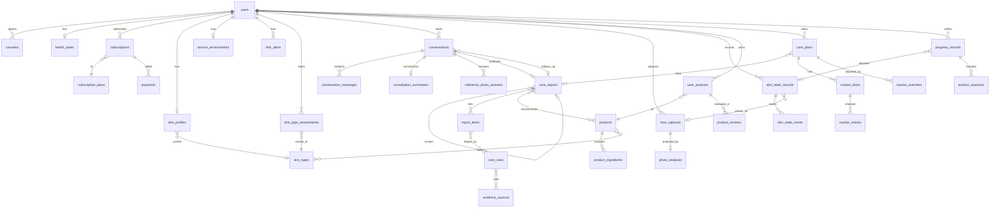

# 데이터 모델 초안 (v0.3)

> 근거 (2026-11-25 기준)
> - Figma "제대로 IA": 핵심 유저플로우 v1.3, 02 핵심 유저플로우(조건·분기·복귀), NEW IA, IA 정보구조도, 제대로의 핵심 구조, 실제 피부 상담 User Flow, 경과 기록 기준, 2-3(3D)
> - Figma "제대로 UI": 화면 약 60개
>
> 결정 반영
> - 피부 유형은 바우만이 아니라 **자체 유형**. 내부 코드 `TYPE_01`~`TYPE_32`, 사용자에게는 줄글 제목("번들거리고 예민한 유형" 등)으로 보여 준다.
> - 제품은 **자체 제품 DB**(PX 제품).
> - 사진 분석과 3D 얼굴 생성은 모두 **자체 API**로 받아 온다.
> - 피부 질환·복용약(민감정보)과 구독·멤버십은 **MVP에 포함**한다.
> - 룰 DB·근거 자료는 **스프레드시트**로 작성해 일괄 등록한다.
> - 상담 비서 스타일은 **구분하지 않는다**(선택 화면 없음).
>
> 확정 전 초안이다. 6절 "결정 필요"를 정한 뒤 Flyway 마이그레이션으로 옮긴다.

## 1. 화면 ID → 도메인

IA v1.3의 화면 ID를 기준으로 한다.

| 화면 ID | 화면 | 도메인 | 비고 |
|---|---|---|---|
| H-01 | 홈 | (조회) | 새 상담 시작, 최근 상담, 추천 제품 |
| C-01 | AI 피부 상담 | 상담 대화 | 증상·생활환경·보유제품·관리 가능 시간·목표일 문진. 상태: 문진 / 선택 카드(사진·3D) / 솔루션 / 후속 상담 |
| C-01 내부 | 조건부 사진 예시 도움 | 예시 사진 응답 | 비슷한 예시 사진 2장 이상 비교 → 유사 / 둘 다 / 없음 / 모름. **실제 피부 사진·3D로 저장하지 않음** |
| C-02 | 상담 내용 확인 | 상담 요약 | 수정 시 C-01 수정 모드 → C-02 복귀 |
| C-01 솔루션 | 관리 솔루션 요약 | 관리 리포트 | 리포트와 **같은 결과**를 대화 안에서 보여 줌 |
| R-01 | 관리 리포트 상세 | 관리 리포트 | 해야 할 행동·피할 행동·근거·D-day 계획·제품 추천. 목표일 없으면 일반 계획 |
| P-02 | 제품 상세 | 제품 | 제품 정보·추천 이유·보유 여부 |
| D-01 | 촬영·3D 생성 | 얼굴 촬영·3D | **선택 사항.** 건너뛰기·취소·실패해도 문진 계속 |
| D-02 | 3D 상태 표시·확인 | 피부 상태 표시 | 부위·상태·메모. 저장 후 호출한 화면(C-01 / C-02 / M-03 / U-05)으로 복귀 |
| 2.3 | 내 3D 얼굴 | 얼굴 기록 | 최신 확정 기록 표시, 이전 기록 비교 진입 |
| 2-1, 2-2 | 기본 정보·피부 특성, 피부 유형 문진 | 피부 프로필, 유형 평가 | 기본 정보와 피부 특성 문진은 유형 평가와 별도 |
| 3, 3.1, 3.1.1 | PX 제품 목록·상세·성분·리뷰 조회 | 제품 | |
| 3.2, 3.2.1 | 내 보유제품, 리뷰 작성 | 보유 제품, 리뷰 | 상담 중 보유제품 선택 시 3.2로 이동 |
| U-02 | 루틴 적용·수정 | 관리 계획 | 행동·알림 시간·목표일 조정 후 적용. **같은 리포트의 행동은 중복 적용 안 함** |
| U-01 | 오늘의 루틴 | 루틴 체크 | 오늘 할 행동, 실행 여부 체크 |
| U-03 | 관리 계획 상세 | 관리 계획 | 날짜별 계획, 수정·리포트·기록 진입 |
| U-05 | 경과 기록 작성 | 경과 기록 | 증상·실행 결과 입력, 사진·3D는 선택 첨부. 저장 후 출발 화면(U-01 / U-03 / U-04)으로 복귀 |
| U-04 | 경과 기록 조회 | 경과 기록 | 날짜·부위별 기록, 변화 확인, 추가 상담 |
| C-01 후속 | 기록을 반영한 상담 | 상담 대화 | 기존 리포트·경과 맥락을 유지하고 문진 이어가기 → 수정 리포트 |
| 2-4 | 설정, 구독 관리, 멤버십, 약관 | 사용자, 구독 | |

**과거 리포트는 당시 결과로 보존한다.** 수정 리포트는 새 행으로 만들고 이전 리포트를 가리킨다.

## 2. 상담 흐름에서 데이터가 생기는 지점

```
홈 → 상담 시작 → 저장된 피부 프로필 반영 여부
   → 현재 고민 입력 → 추가 문진 (부위 표시 / 예시 사진 / 선택 촬영·3D)
   → 위험 신호 점검 ──있음──→ 즉시 의료진(의무실) 상담 안내 → 상담 종료
   → 군 생활환경·관리 제약 확인
   → 입력 요약 확인(C-02) ──수정──→ C-01
   → 근거 자료 매핑 ──근거 부족──→ 불확실성·안내 한계 고지
   → 솔루션 = 관리 리포트(R-01) → 루틴 적용(U-02)
```

재방문 시 "지난번과 달라진 점이 있나요?"로 분기한다.
- 같고 방법도 맞았어요 → 지난 방법 바로 꺼내기
- 시간이나 물품이 달라요 → 지금 가능한 행동 고르기
- 불편이 심해졌어요 → 의무실 상담 안내

## 3. ERD



## 4. 테이블

### 4.1 사용자·구독
- **users**: `id`, `kakao_id`(unique), `nickname`, `email`(nullable, 카카오 비즈앱 동의 시), `profile_image_url`, `created_at`, `deleted_at`
- **user_settings**: `user_id`(PK), `notifications_enabled`, `marketing_consent`, …
- **consents**: `id`, `user_id`, `type`(TERMS / PRIVACY / SKIN_PROFILE / SENSITIVE_HEALTH / FACE_CAPTURE), `agreed_at`, `revoked_at` — IA "동의 후 피부 프로필 저장", 얼굴 촬영 허용
- **subscription_plans** (기준 데이터): `code`(PK), `name`, `price`, `billing_period`(MONTH / YEAR), `benefits`(text[]), `active`
- **subscriptions** (2-4-1 구독 관리, 2-4-1-1 멤버십 상세): `id`, `user_id`, `plan_code`, `status`(ACTIVE / CANCELED / EXPIRED / PAST_DUE), `provider`, `provider_subscription_id`, `started_at`, `current_period_end`, `canceled_at`
- **payments**: `id`, `subscription_id`, `provider`, `provider_payment_id`(unique), `amount`, `status`(PAID / FAILED / REFUNDED), `paid_at`
- 결제 카드 정보는 저장하지 않는다. 결제 대행사(PG)의 빌링키·결제 ID만 보관한다.

### 4.2 피부 유형 (자체 32유형)
- **skin_types** (기준 데이터, 32행): `code`(PK, `TYPE_01`~`TYPE_32`), `title`(예: 번들거리고 예민한 유형), `description`, `axis_values`(jsonb: 유형을 이루는 축별 값), `care_points`(text[]), `sort_order`
- **skin_type_questions** (기준 데이터): `id`, `version`, `axis`, `text`, `options`(jsonb), `sort_order` — IA 규칙: 선택지에 "모르겠음", "기타" 넣지 않음
- **skin_type_assessments**: `id`, `user_id`, `question_version`, `answers`(jsonb), `axis_scores`(jsonb), `result_type_code` → `skin_types.code`, `created_at`
- 화면 표시는 `skin_types.title`, 제품 추천·행동 규칙은 `code`로 연결한다.

### 4.3 피부 프로필·복무 환경
- **skin_profiles** (1:1): `user_id`, `skin_type_code`(최신 평가 결과, nullable), `oil_tendency`, `sensitivity`, `recurring_patterns`(text[]), `concerns`(text[]), `use_in_consultation`(기본값), `updated_at`
- **health_notes** (민감정보, MVP 포함): `user_id`, `conditions`(text[]: 피부 질환), `medications`(text[]: 복용약), `consent_id` → `consents`(`SENSITIVE_HEALTH`), `updated_at`
  - `SENSITIVE_HEALTH` 동의 없이는 저장·조회하지 않는다. 동의 철회 시 삭제한다. 컬럼 단위 암호화를 적용한다.
- **service_environments** (군 복무 환경, 1:1): `user_id`, `wash_available_time`(예: 저녁 21시 이후), `outdoor_training_frequency`(예: 주 2~3회), `duty_pattern`(근무 형태), `product_access`(PX 접근성), `unit_constraints`(부대 분위기·제약, 자유 입력), `updated_at`
- **skin_alerts** (알레르기·자극): `id`, `user_id`, `target`(성분명 또는 제품명), `product_id`(nullable), `reaction`, `created_at`

### 4.4 상담
- **conversations**: `id`, `user_id`, `kind`(CONSULT / ROUTINE_ADJUST), `use_saved_profile`(bool), `follows_report_id`(nullable, 후속 상담일 때 이전 리포트), `title`(예: 면도 후 턱 따가움), `state`(INTAKE / SUMMARY_REVIEW / COMPLETED / REFERRED / ABANDONED), `outcome`(REPORT / MEDICAL_REFERRAL / INSUFFICIENT_EVIDENCE, nullable), `created_at`, `completed_at`
- **conversation_messages**: `id`, `conversation_id`, `role`(USER / ASSISTANT), `content`, `payload`(jsonb: 빠른 답변·선택 카드 등), `created_at`
- **consultation_summaries** (C-02): `conversation_id`(PK), `concern_type`, `regions`(jsonb: 부위·좌우·개수), `symptoms`(text[]: 붉어짐·따가움), `onset`, `duration`, `severity_change`, `activities`(text[]: 야외훈련·면도·방독면), `care_available_from`, `available_products`(jsonb: 보유제품 ID 또는 종류), `target_date`(nullable, 목표일), `red_flags`(jsonb), `edited_by_user`(bool), `confirmed_at`
- **reference_photo_answers** (C-01 예시 사진 도움): `id`, `conversation_id`, `question_key`, `reference_photo_ids`(text[]), `answer`(SIMILAR / BOTH / NONE / UNKNOWN), `created_at` — 참고 응답일 뿐이다. 진단이나 피부 사진으로 쓰지 않는다.
- **reference_photos** (기준 데이터): `id`, `appearance_code`, `image_url`, `features`(text[])

### 4.5 관리 리포트·근거
- **care_reports** (C-01 솔루션 = R-01): `id`, `conversation_id`(unique), `user_id`, `revises_report_id`(nullable, 수정 리포트), `change_reason`(nullable), `today_summary`, `context`, `target_date`(nullable → D-day 계획, 없으면 일반 계획), `plan`(jsonb: 날짜별 계획), `uncertainty_notice`(text), `created_at` — 생성 후 수정하지 않는다(당시 결과 보존).
- **report_items**: `id`, `report_id`, `kind`(DO / DONT / AFTERCARE / CAUTION / MEDICAL_WHEN), `text`, `sort_order`
- **report_item_rules**: `report_item_id`, `rule_id`
- **report_products**: `report_id`, `product_id`, `reason`, `sort_order`
- **care_rules** (룰 DB, IA "핵심 구조"): `id`, `sheet_key`(unique, 스프레드시트 행 ID), `problem_type`, `condition`(jsonb: 상태·개인 특성(`skin_type_code` 포함)·환경·제약), `red_flags`(jsonb), `recommended_actions`(text[]), `avoid_actions`(text[]), `recheck_after`, `referral_condition`, `requires_professional`(bool), `active`, `version`
- **evidence_sources**: `id`, `sheet_key`(unique), `title`, `source_type`(PAPER / GUIDELINE / STAT), `url`, `summary`, `published_at`
- **care_rule_evidences**: `rule_id`, `evidence_id`
- **sheet_imports**: `id`, `target`(CARE_RULES / EVIDENCE_SOURCES / PRODUCTS / SKIN_TYPES), `file_name`, `row_count`, `inserted`, `updated`, `deactivated`, `errors`(jsonb), `imported_by`, `imported_at`
- 등록 방식: 스프레드시트(xlsx 또는 csv)를 올리면 `sheet_key` 기준으로 추가·수정하고, 시트에서 빠진 행은 `active = false`로 바꾼다(삭제하지 않음: 과거 리포트가 참조하기 때문). 검증 오류가 하나라도 있으면 전체를 반영하지 않는다.

### 4.6 얼굴 촬영·3D·피부 상태 표시
- **face_captures** (D-01): `id`, `user_id`, `photo_s3_keys`(text[]), `external_job_id`(자체 API 작업 ID), `model_s3_key`(nullable, API에서 받은 3D 결과를 S3에 보관), `status`(PENDING / READY / FAILED), `error`, `captured_at`, `deleted_at`
- **photo_analyses** (3-3, 자체 API): `capture_id`(PK), `status`, `observations`(jsonb: [{항목, 수준: OBSERVED / PARTIAL / UNDETERMINED, 설명}]), `key_points`(text[]), `model_version`, `raw_response`(jsonb), `analyzed_at`, `error`
- **skin_state_records** (D-02 저장 단위): `id`, `user_id`, `capture_id`(nullable: 사진 없으면 마지막 촬영 자료로 표시), `source`(CONSULT / SUMMARY / PROFILE / PROGRESS), `source_id`, `recorded_at`, `confirmed`(bool) — **촬영일(`face_captures.captured_at`)과 상태 기록일(`recorded_at`)을 구분**한다.
- **skin_state_marks**: `id`, `record_id`, `region`(CHEEK / CHIN / JAW / FOREHEAD / NOSE / …), `side`(L / R / BOTH), `appearance`(REDNESS / OILY / PUSTULE / FLAKY / BUMPY / OTHER), `sensations`(text[]), `count`, `memo`
- 프로필(2.3)은 사용자의 최신 `confirmed` 기록을, 루틴·경과(U-04)는 날짜별 기록 비교를 쓴다.

### 4.7 제품 (자체 PX 제품 DB)
- **products**: `id`, `sheet_key`(unique), `brand`, `name`, `volume`, `price`, `category`(CLEANSER / TONER / LOTION / CREAM / SUNSCREEN / AMPOULE / …), `description`, `features`(text[]), `cautions`(text), `full_ingredients`(text), `source`(정보 출처), `image_url`, `px_available`(bool), `rating_avg`, `review_count`, `updated_at`
- **product_ingredients**: `product_id`, `name`, `is_key`, `sort_order`
- **product_skin_type_fits**: `product_id`, `skin_type_code`, `score`(0~100, 궁합점수), `reason` — 매칭률(%)과 "추천 근거"를 이 표에서 가져온다.
- **user_products** (3.2): `id`, `user_id`, `product_id`, `role`(세안제 / 보습제 / …), `started_on`, `ended_on`
- **product_reviews** (3.2.1): `id`, `user_product_id`, `satisfaction`(1~5), `good_tags`(text[]), `bad_tags`(text[]), `comment`, `created_at`

### 4.8 루틴·관리 계획·경과
- **care_plans** (U-02 / U-03): `id`, `user_id`, `report_id`(nullable), `goal_type`(VACATION / OUTING / OVERNIGHT / CUSTOM / NONE), `goal_label`, `target_date`(nullable), `start_date`, `status`(ACTIVE / ARCHIVED), `created_at`
- **routine_items**: `id`, `care_plan_id`, `source_report_item_id`(nullable), `time_of_day`(MORNING / EVENING), `title`, `user_product_id`(nullable), `reminder_time`(nullable), `sort_order` — unique(`care_plan_id`, `source_report_item_id`)로 같은 리포트 행동 중복 적용 방지
- **routine_checks** (U-01): `routine_item_id`, `date`, `checked_at` — PK(`routine_item_id`, `date`). 실천률은 조회 시 계산
- **routine_overrides** (지금 가능한 루틴으로 바꾸기): `id`, `care_plan_id`, `reason`(OUTDOOR_TRAINING / DUTY / OTHER), `wash_availability`(NOW / EVENING / UNKNOWN), `start_date`, `end_date`, `items`(jsonb), `conversation_id`(nullable, AI 비서로 만든 경우), `created_at` — 기존 계획은 그대로 두고 선택 기간에만 반영
- **progress_records** (U-05): `id`, `user_id`, `care_plan_id`(nullable), `date`, `perceived_change`(BETTER / SAME / WORSE / UNSURE), `condition`(COMFORT / NORMAL / UNCOMFORTABLE, nullable), `symptoms`(text[]), `execution_note`, `environment_note`, `state_record_id`(nullable, 사진·3D 첨부), `created_at`
- **product_reactions**: `id`, `user_product_id`, `progress_record_id`(nullable), `date`, `reaction`(BETTER / NO_CHANGE / IRRITATION / UNSURE), `symptoms`(text[]), `onset_note`, `memo`, `created_at`
- 경과 기록 이후 행동(IA "경과 기록 기준"): BETTER → 계획 유지 여부 확인, SAME → 실행 상황 보고 유지·조정, WORSE → 추가 문진(후속 상담), UNSURE → 말·사진으로 보완하고 부족하면 판단 보류. 이 분기는 서비스 로직이며 별도 테이블은 두지 않는다.

## 5. API 초안

| 메서드 | 경로 | 화면 ID |
|---|---|---|
| GET | `/api/me` | 공통 |
| GET | `/api/home` | H-01 |
| POST | `/api/conversations` (`followsReportId`, `useSavedProfile`) | C-01 시작·후속 |
| POST | `/api/conversations/{id}/messages` (SSE 스트리밍) | C-01 |
| POST | `/api/conversations/{id}/reference-answers` | C-01 예시 사진 |
| GET | `/api/reference-photos?appearance=` | C-01 예시 사진 |
| GET / PUT | `/api/conversations/{id}/summary` | C-02 |
| POST | `/api/conversations/{id}/report` | C-02 → 솔루션 생성 |
| GET | `/api/reports?limit=` / `/api/reports/{id}` | 최근 상담·R-01 |
| GET | `/api/evidence-sources/{id}` | 근거 자료 상세 |
| POST | `/api/face-captures/upload-urls` | D-01 (S3 presigned) |
| POST | `/api/face-captures` / GET `/api/face-captures/{id}` | D-01 생성·상태 |
| POST | `/api/skin-state-records` / GET `?from=&to=` | D-02 저장, 2.3·U-04 비교 |
| GET / PUT | `/api/skin-profile`, `/api/health-notes`, `/api/service-environment` | 2-1 |
| GET / POST / DELETE | `/api/skin-alerts` | 2-1 |
| GET | `/api/skin-types/{code}` | 유형 결과 |
| GET | `/api/skin-type-questions` / POST `/api/skin-type-assessments` | 2-2 |
| GET | `/api/products?category=&q=&sort=&price=` | 3 |
| GET | `/api/products/{id}` (내 유형 궁합점수·보유 여부 포함), `/api/products/{id}/reviews` | 3.1, P-02 |
| GET / POST / DELETE | `/api/my-products`, POST `/api/my-products/{id}/reviews` | 3.2, 3.2.1 |
| POST | `/api/care-plans` (리포트 적용) / PUT `/api/care-plans/{id}` | U-02 |
| GET | `/api/care-plans/current` | U-03 |
| GET | `/api/routines/today` | U-01 |
| PUT / DELETE | `/api/routine-items/{id}/checks/{date}` | U-01 |
| POST | `/api/routine-overrides` | 지금 가능한 루틴 |
| POST / PUT | `/api/progress-records` | U-05 |
| GET | `/api/progress-records?from=&to=` / `/api/progress/summary?from=&to=` | U-04, 관리 경과 |
| GET / POST / DELETE | `/api/consents` | 동의 관리 |
| GET | `/api/subscription-plans`, `/api/subscription` | 2-4-1, 2-4-1-1 |
| POST | `/api/subscription` / DELETE `/api/subscription` | 구독 시작·해지 |
| POST | `/api/payments/webhook` | 결제 대행사 알림 수신 |
| POST | `/api/admin/sheet-imports` (파일 업로드, `target`) | 룰·근거·제품·유형 일괄 등록 |

## 6. 결정 필요

1. **32유형을 이루는 축:** 축 이름과 판정 기준, `TYPE_01`~`TYPE_32`와 줄글 제목 매핑표 (받을 예정). `skin_types` 초기 데이터로 넣는다.
2. **자체 API 스펙:** 사진 분석·3D 생성의 요청·응답 형식, 동기/비동기(작업 ID 조회 또는 콜백), 결과물 형식.
3. **결제 대행사(PG):** 웹 정기결제에 쓸 PG(예: 토스페이먼츠, 포트원 등)와 요금제 목록.
4. **스프레드시트 양식:** 룰 DB·근거 자료 시트의 실제 컬럼. 받으면 4.5 필드를 시트에 맞춘다.
5. **관리자 권한:** 일괄 등록을 누가 하는지(관리자 계정 구분 방식).
